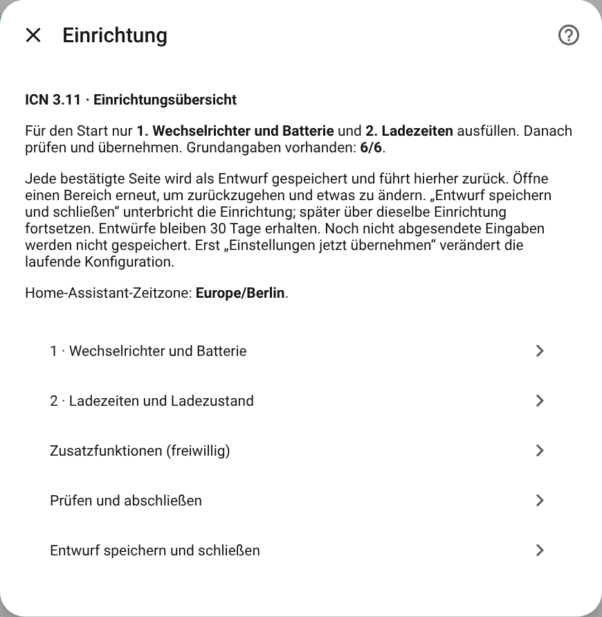
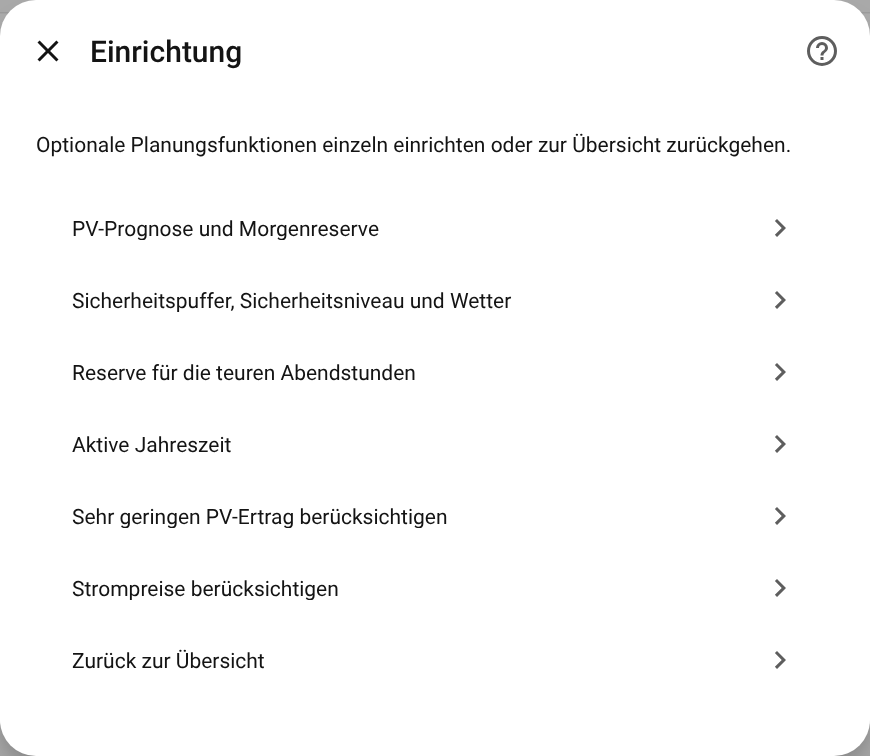
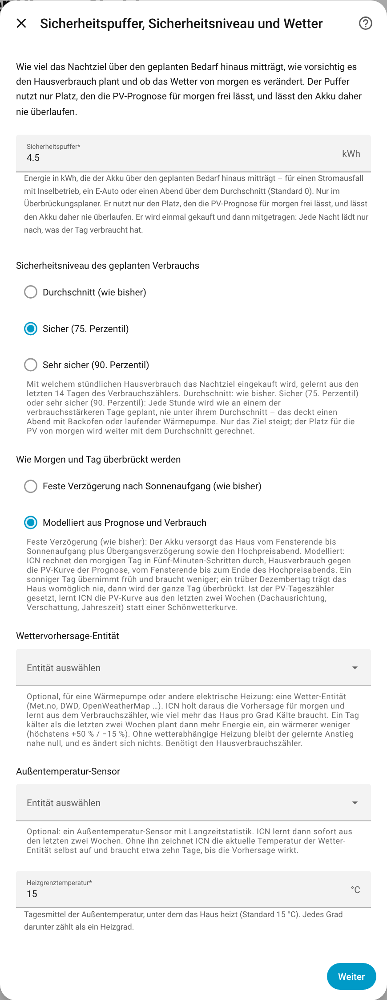

# Referenz der Konfiguration

[🇬🇧 English](../en/configuration.md) · [Übersicht der Dokumentation](README.md)

Alles wird in der Oberfläche eingestellt: **Einstellungen → Geräte & Dienste → Inverter Charge
Night → Konfigurieren**. Der Dialog ist eine Übersicht. Jede Seite speichert in einen Entwurf, und
erst **Einstellungen jetzt übernehmen** ändert die laufende Konfiguration. Die Feldnamen unten sind
die, die der Dialog zeigt. Der Schlüssel in Klammern ist der Name in der Diagnose und im Code.

- [Pflichtseiten](#pflichtseiten)
- [Ladeleistung begrenzen](#ladeleistung-begrenzen)
- [Hausanschluss begrenzen](#hausanschluss-begrenzen)
- [Effizienzsuche einrichten](#effizienzsuche-einrichten)
- [Prognose, Reserve und Jahreszeit](#prognose-reserve-und-jahreszeit)
- [Weitere Funktionen und Hardware](#weitere-funktionen-und-hardware)
- [Empfohlene Einstellungen](#empfohlene-einstellungen)

## Pflichtseiten

### 1 · Wechselrichter und Batterie

| Feld | Standard | Bedeutung |
|---|---|---|
| Name dieser Einrichtung (`name`) | Inverter Charge Night | Ein beliebiger Name. Er benennt die Entitäten des Wechselrichters nicht um. |
| Mindestladestand am Wechselrichter einstellen (`min_soc_entity`) | – | Die beschreibbare Min-SOC-Zahl des Wechselrichters. Sie kennzeichnet auch die Einrichtung: eine Einrichtung je Wechselrichter. |
| Netzladen am Wechselrichter einschalten (`grid_charge_switch`) | – | Der Schalter, mit dem der Wechselrichter aus dem Netz lädt. |
| Aktuellen Akkuladestand messen (`battery_soc_entity`) | – | Der gemessene Ladestand in %. |
| Bruttokapazität des Akkus (`battery_capacity`) | – | kWh für 0–100 % des gemeldeten Ladestands. Zieh den Min-SOC nicht ab. |
| PV-Ertragsprognose für morgen (`pv_forecast_entity`) | – | Die Prognose für den ganzen morgigen Tag in kWh. Kein ICN-Sensor wie die Abendvorschau. |

### 2 · Ladezeiten und Ladezustand

| Feld | Standard | Bedeutung |
|---|---|---|
| Beginn / Ende des günstigen Ladefensters (`start_time`, `end_time`) | 00:00 / 05:59 | Ortszeit in der Zeitzone von Home Assistant. Darf über Mitternacht laufen. |
| Untergrenze / Obergrenze des Ladeziels (`user_min_soc`, `user_max_soc`) | 8 % / 100 % | Das Ziel bleibt immer in diesem Bereich. |

## Ladeleistung begrenzen

Ohne Ladegrenze lädt der Wechselrichter mit der Leistung, die er selbst wählt. Mit einer Ladegrenze
schreibt ICN die gleichbleibende Leistung, mit der das Ziel genau am Ende des Fensters erreicht
wird: im Modus Überbrückung, mit einer Begrenzung am Hausanschluss oder sobald die Effizienzsuche
ein Optimum gefunden hat. Im Modus Freiraum ohne eines davon zeigt der Sensor *Geplante
Ladeleistung* den Plan nur an (Attribut `applied`).

| Feld | Standard | Bedeutung |
|---|---|---|
| Ladeleistung am Wechselrichter einstellen (Watt-Steller) (`charge_power_entity`) | – | Eine beschreibbare Ladeobergrenze in W (oder kW), die ihren Wert zurückmeldet. Kein Prozent-Sollwert wie Kostals *Active Power Set Point*. |
| Kleinste nutzbare Ladeleistung (`min_charge_power_w`) | 1000 W | Ein kleinerer Plan wird auf diesen Wert angehoben. Nur wenn der Hausanschluss weniger übrig lässt, pausiert das Laden. |
| Höchste erlaubte Ladeleistung (`max_charge_power_w`) | 10000 W | Obergrenze für die Planung und die Effizienzsuche. Darf die Nennwerte von Wechselrichter, Akku und Installation nicht überschreiten. |

## Hausanschluss begrenzen

Hält den gesamten Netzbezug unter einem Dauerbudget, indem der Akku zurückgehalten wird
([Details](safety.md#hausanschluss)). Alle vier Felder werden zusammen gebraucht.

| Feld | Standard | Bedeutung |
|---|---|---|
| Gesamten Netzbezug des Hauses messen (`grid_import_entity`) | – | Gesamter Bezug am Netzanschlusspunkt, positiv, in W oder kW, einschließlich Akku und Autos. |
| Erlaubter dauerhafter Netzbezug des Hauses (`grid_max_continuous_w`) | – | Das Budget in W, das sich alle Verbraucher teilen. |
| Freizuhaltender Sicherheitsabstand zum Budget (`grid_headroom_w`) | 500 W | Wird zusätzlich freigehalten. |
| Ladeleistung am Wechselrichter einstellen (Watt-Steller) (`charge_power_entity`) | – | Wie oben. |

Statt des Budgets kannst du ICN es aus der Sicherung berechnen lassen: **Weitere Funktionen und
Hardware → Hausanschluss aus Sicherungsdaten berechnen** (Vorsicherung je Phase, Phasen des
Hausanschlusses (3), Strangspannung (230 V), Dauerlastanteil (80 %)). 63 A auf drei Phasen ergeben
43,5 kW Nennleistung und 34,8 kW Dauerleistung. Ein direkt eingegebenes Budget hat Vorrang vor der
Berechnung aus der Sicherung, und das Speichern der Sicherungsseite entfernt ein solches Budget.

## Effizienzsuche einrichten

Misst, bei welcher Ladeleistung am wenigsten Energie verloren geht, und hält sich dann daran
([Details](efficiency-search.md)). Braucht die Ladegrenze, die AC-Seite der Ladung und die
Akkuseite:

| Feld | Bedeutung |
|---|---|
| Hausverbrauch (Leistung) (`charge_power_house_entity`) | Empfohlen. Was das Haus selbst verbraucht, in W, ohne den Akku. Mit dem Netzbezug ergibt das die AC-Aufnahme des Ladegeräts: Netzbezug minus Hausverbrauch. KOSTAL KORE: *Home Power*. |
| Netzbezug (Leistung) (`grid_import_entity`) | Der Bezug am Hausanschluss, positiv beim Bezug. Dasselbe Feld wie für die [Begrenzung des Hausanschlusses](#hausanschluss-begrenzen). |
| AC-Eingangsleistung nur für die Batterieladung (`charge_power_sent_entity`) | Nur statt des Paars oben, und nur ein Sensor, der die AC-Aufnahme des Ladegeräts selbst misst. Nicht KOSTAL KORE *Grid to Battery Power*, das ist die DC-Leistung des Akkus, und nicht die gesamte AC-Leistung des Wechselrichters. |
| DC-Ladeleistung, die am Akku ankommt (`charge_power_received_entity`) | Die DC-Leistung, die im Akku ankommt. KOSTAL KORE: *Battery Power*. Zählt der Sensor Laden negativ, wird das automatisch umgedreht. |

Zwei kWh-Zähler für dieselben beiden Größen (Seite *Effizienz-Messwerte und Energiezähler*:
*Energiezähler: aufgenommen*, *Energiezähler: im Speicher angekommen*) sind freiwillig und machen
das Ergebnis genauer.

## Prognose, Reserve und Jahreszeit

### PV-Prognose und Morgenreserve

| Feld | Standard | Bedeutung |
|---|---|---|
| Planer (`planner_mode`) | Freiraum | *Freiraum*: hält nur Platz für die Prognose frei. *Überbrückung*: deckt außerdem das Haus vom Ende des Fensters, bis die PV übernimmt ([wie](how-it-works.md#überbrückung-empfohlen)). |
| Zusätzlicher Speicherplatz für PV-Ertrag (`forecast_error_margin`) | 10 % | Wie weit die Prognose danebenliegen darf. Wird zur sicheren Seite hin angewendet: mehr Platz für die Sonne, weniger Sonne für den Abend. |
| Rückfallwert beim Zurücksetzen des Mindestladestands (`default_min_soc`) | die Untergrenze | Wird nur verwendet, wenn der ursprüngliche Min-SOC nicht gelesen werden konnte. Eine neue Einrichtung übernimmt die Untergrenze von Seite 2. |
| PV-Ertragsprognose für heute (`pv_forecast_today_entity`) | – | Nötig für Fenster nach Mitternacht, die Abendvorschau und die Abregelungsvorschau. |
| Energiezähler des Hausverbrauchs (`house_load_entity`) | – | Fortlaufender kWh-Zähler. ICN lernt daraus ein Stundenprofil der letzten 14 Tage. |
| Mittlerer Hausverbrauch (`avg_house_load_kw`) | 0,5 kW | Wird verwendet, wenn es keinen Zähler oder noch keine Statistiken gibt. |
| Verzögerung bis PV den Verbrauch deckt (`pv_crossover_delay_min`) | 90 min | Minuten nach Sonnenaufgang, bis die PV das Haus trägt (Modell mit fester Verzögerung). |
| Reserve für die Überbrückung (`bridge_reserve_kwh`) | 0,5 kWh | Wird zum Bedarf am Morgen addiert. |

### Sicherheitspuffer, Sicherheitsniveau und Wetter

| Feld | Standard | Bedeutung |
|---|---|---|
| Sicherheitspuffer (`safety_buffer_kwh`) | 0 kWh | Wird über dem Bedarf mitgeführt, nur in den Platz, den die PV frei lässt. Einmal gekauft, dann mitgeführt. |
| Sicherheitsniveau des geplanten Verbrauchs (`load_safety_level`) | Durchschnitt | *Durchschnitt*, *Sicher (75. Perzentil)* oder *Sehr sicher (90. Perzentil)* der letzten 14 Tage, je Stunde. |
| Wie Morgen und Tag überbrückt werden (`bridge_model`) | Feste Verzögerung nach Sonnenaufgang | *Feste Verzögerung nach Sonnenaufgang* oder *Modelliert aus Prognose und Verbrauch*: der morgige Tag, alle fünf Minuten gegen die PV-Kurve durchgerechnet. |
| Wettervorhersage-Entität (`weather_entity`) | – | Optional, für elektrisches Heizen: Die Temperatur von morgen skaliert den geplanten Verbrauch. |
| Außentemperatur-Sensor (`outdoor_temperature_entity`) | – | Optional: Damit lernt ICN sofort aus den letzten zwei Wochen. |
| Heizgrenztemperatur (`heating_limit_c`) | 15 °C | Tagesmittel, unter dem das Haus heizt. |

### Reserve für die teuren Abendstunden

| Feld | Standard | Bedeutung |
|---|---|---|
| Hochpreiszeit, Beginn / Ende (`high_price_start`, `high_price_end`) | – | Zum Beispiel 18:00–21:00. Beide oder keines. |
| Zuschlag auf den Abendverbrauch (`high_price_margin_pct`) | 0 % | Kommt für den Nachtplan zum gelernten Durchschnitt hinzu. Die Hochpreisrettung rechnet ohne ihn. |
| Entladesperre für Reservierungen (`discharge_block_mode`) | Automatisch | Für ausdrückliche Reservierungen und die Hochpreisrettung: *Automatisch* hebt den Min-SOC auf den Stand, der gehalten wird, *Aus* hält nur das Ziel. Planmäßige Nächte sind nicht betroffen. |
| Schalter „Entladung sperren“ (`discharge_block_switch`) | – | Altlast. Wird nur verwendet, um einen Zustand zurückzugeben, den eine Version vor 3.10.6 verändert hat. |

### Aktive Jahreszeit

| Feld | Standard | Bedeutung |
|---|---|---|
| Beginn / Ende des aktiven Zeitraums | – | Nur zwischen diesen Daten laufen. Leer heißt: das ganze Jahr. |
| Datumsbereich jährlich wiederholen | An | Nur Tag und Monat zählen, sodass 1. Oktober – 31. März jeden Winter wiederkommt. Aus: Die Daten gelten absolut, und nach dem Enddatum hört ICN endgültig auf (und meldet das unter Reparaturen). |

### Sehr geringen PV-Ertrag berücksichtigen

Mit der Prognose für heute und einem Zähler für den PV-Tagesertrag (*Tatsächlicher
PV-Tagesertrag*, `pv_energy_today_entity`, wird jeden Tag zurückgesetzt) vergleicht ICN die
Prognose des Tages mit dem, was wirklich erzeugt wurde. Ein Tag mit mindestens 5 kWh erwartetem
Ertrag und höchstens 15 % davon geliefert setzt die nächste Nacht auf den Max-SOC
([Details](extras.md#sehr-geringer-pv-ertrag)). Derselbe Zähler speist die gelernte PV-Kurve des
modellierten Tages.

### Strompreise berücksichtigen

| Feld | Bedeutung |
|---|---|
| Preis im Fenster / Preis außerhalb des Fensters / Einspeisevergütung (ct/kWh) | Feste Preise, alle drei oder keiner. Sie entscheiden einen Widerspruch zwischen dem Bedarf am Morgen und dem Platz für die PV. |
| Strompreis-Entität | Optional: ein Sensor mit Stundenpreisen für heute und morgen (Tibber, aWATTar, EPEX Spot, Nordpool, ENTSO-e und ähnliche). Er ersetzt den Preis im und außerhalb des Fensters. Die Einspeisevergütung bleibt ein festes Feld. Die [Hochpreisrettung](extras.md#hochpreisrettung) kauft nur mit ihr aus dem Netz. |
| Worin die Preise angegeben sind | *Automatisch erkennen*, oder setze die Einheit, wenn die Entität keine mitbringt. |
| Zuschlag auf den Börsenpreis / Zuschlag im Fenster | Was deine Rechnung zum Preis der Entität hinzufügt (Netzentgelt, Umlagen, Mehrwertsteuer). Der zweite Wert ist für ein reduziertes Netzentgelt nach §14a im Fenster. |

Der Sensor *Preissignal* zeigt, welche Preise verwendet wurden.

## Weitere Funktionen und Hardware

| Seite | Felder |
|---|---|
| **Effizienz-Messwerte und Energiezähler** | Die Leistungssensoren der Effizienzsuche, dazu freiwillig kWh-Zähler für beide Seiten (*Energiezähler: aufgenommen*, *Energiezähler: im Speicher angekommen*). |
| **Inselbetrieb erkennen** | *Entität für Notstrom-/Inselbetrieb* und, wenn es ein einfacher Sensor ist, die *Zustände für Notstrombetrieb*, die Inselbetrieb bedeuten (Kostal: `ESB`). Dringend empfohlen bei einem Notstrom- oder Umschalter ([Details](safety.md#stromausfall-und-inselbetrieb)). |
| **Zusätzliche Hardwaregrenzen** | Eine zweite, unabhängige Ladeobergrenze (*Zusätzlicher Hardwaredeckel: eigener Watt-Steller* und *Zusätzlicher Hardwaredeckel: Leistungswert*, beide oder keines). Meist leer. Die *Entität für die Entladeleistungsgrenze* ist eine Altlast, nur um einen alten Wert zurückzugeben. |
| **Hausanschluss aus Sicherungsdaten berechnen** | Siehe [Hausanschluss](#hausanschluss-begrenzen). |
| **Weitere Einstellungen** | *Abfrageintervall* (900 s), *Befehlsverzögerung* (0,1 s), *Ladewirkungsgrad* (0,90) und *Entladewirkungsgrad* (0,95), *Einspeisegrenze* und *Einspeiseleistung* für die [Abregelungsvorschau](extras.md#abregelungsvorschau), die *Betriebsart* und der *Zwangsentlade-Schalter (für Morgen-Entladung erforderlich)* für die [Morgenentladung](morning-discharge.md). |
| **Funktionen ausschalten** | Schaltet die Effizienzsuche, die Begrenzung am Hausanschluss, die Erkennung von PV-Ertragsausfall oder die Steuerung der Ladeleistung in einem Schritt aus. |

## Empfohlene Einstellungen

**Ein typischer deutscher §14a-Haushalt mit Wärmepumpe** (Akku mit 35,8 kWh, Fenster 23:00–05:00,
Hochpreiszeit 18:00–21:00):

| Einstellung | Wert |
|---|---|
| Fenster | 23:01 – 04:58 |
| Min-/Max-SOC | 8 % / 100 % |
| Planer | Überbrückung |
| Prognose für heute | gesetzt |
| Zähler für den Hausverbrauch | gesetzt |
| Sicherheitspuffer | 4–5 kWh |
| Sicherheitsniveau | Sicher (75. Perzentil) |
| Überbrückung | Modelliert aus Prognose und Verbrauch |
| Wetter-Entität + Außensensor | gesetzt |
| Hochpreiszeit | 18:00 – 21:00 |
| Ladegrenze | gesetzt (beschreibbarer W-Steller) |
| Inselerkennung | gesetzt, wenn du einen Umschalter hast |
| Jahreszeit | 1. Oktober – 31. März, jährlich |

**Vorsichtig anfangen:** Lass den Planer auf *Freiraum*, setze nur die beiden Pflichtseiten und die
Inselerkennung und beobachte den Sensor *Zielladestand* ein paar Nächte lang. Dann wechsle zu
*Überbrückung* und ergänze die Ladegrenze und den Rest.
