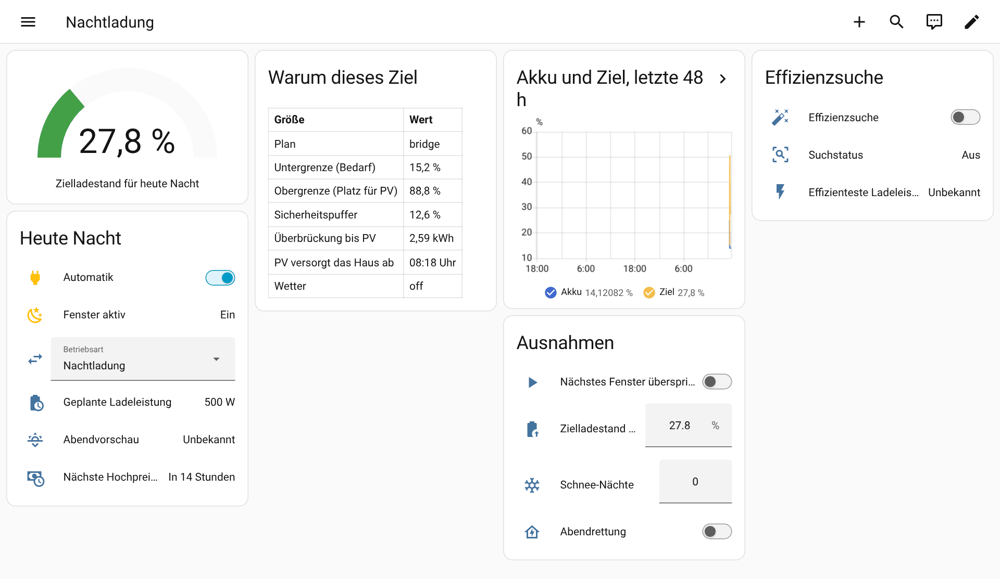

# Dashboard

[🇬🇧 English](../en/dashboard.md) · [Übersicht der Dokumentation](README.md)

Eine Beispielansicht, die nur Karten verwendet, die mit Home Assistant ausgeliefert werden: das Ziel
als Messanzeige, die Nacht auf einen Blick, warum das Ziel so ausgefallen ist, die letzten
48 Stunden, die Ausnahmen und die Effizienzsuche.



## Einfügen

1. Kopiere [`docs/examples/dashboard.de.yaml`](../examples/dashboard.de.yaml). Sie nutzt die
   Entity-IDs eines Home Assistant, der auf Deutsch eingestellt ist. Auf einem englischen System
   nimmst du die [englische Fassung](../examples/dashboard.yaml).
2. Ersetze `sensor.battery_soc` durch den Ladestandssensor deines Akkus. Wenn deine Einrichtung
   einen anderen Namen hat, passt du auch die Entity-IDs von ICN an. Die Sensoren der Effizienzsuche
   sind standardmäßig deaktiviert; aktiviere sie auf der Geräteseite oder entferne die letzte Karte.
3. Öffne ein Dashboard, **Dashboard bearbeiten → ⋮ → Raw-Konfigurationseditor**, und füge die
   Ansicht als einen Eintrag unter `views:` ein. Oder kopiere einzelne Karten mit
   **Karte hinzufügen → Manuell** in eine bestehende Ansicht.

## Einzelne Karten

**Ziel und Fenster:**

```yaml
type: entities
title: Heute Nacht
state_color: true
entities:
  - switch.inverter_charge_night_automatik
  - binary_sensor.inverter_charge_night_fenster_aktiv
  - sensor.inverter_charge_night_zielladestand
  - sensor.inverter_charge_night_geplante_ladeleistung
  - sensor.inverter_charge_night_abendvorschau
```

**Akku und Ziel über zwei Tage:**

```yaml
type: history-graph
title: Akku und Ziel
hours_to_show: 48
entities:
  - entity: sensor.battery_soc
    name: Akku
  - entity: sensor.inverter_charge_night_zielladestand
    name: Ziel
```
