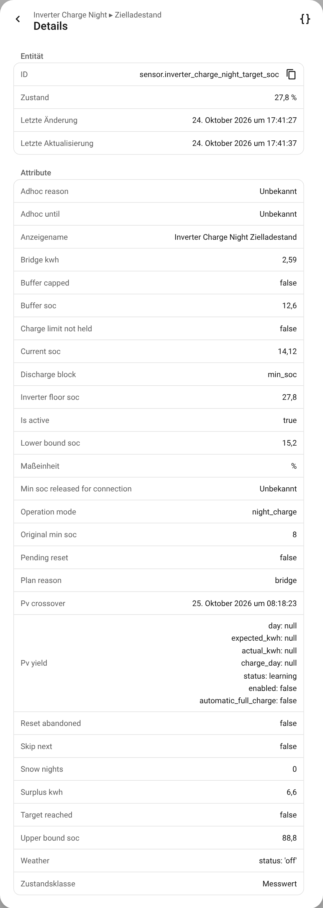

# Entitäten und Aktionen

[🇬🇧 English](../en/entities-and-actions.md) · [Übersicht der Dokumentation](README.md)

Alle Entitäten gehören zu einem Gerät. Es heißt so wie das Feld *Name* der Einrichtung (Standard:
**Inverter Charge Night**). Die Namen sind übersetzt (Englisch und Deutsch werden mit der
Integration ausgeliefert). Die Entity-IDs unten sind die, die Home Assistant für den Standardnamen
anlegt, wenn es beim Einrichten auf **Deutsch** eingestellt ist: Home Assistant bildet die IDs in der
Systemsprache. Auf Englisch heißen sie zum Beispiel `sensor.inverter_charge_night_target_soc`
(siehe die [englische Seite](../en/entities-and-actions.md)). Bei einem anderen Namen oder nach
einem Update von einer älteren Version prüfst du die IDs auf der Geräteseite.

## Entitäten

### Steuerung

| Name | Entity-ID | Wofür |
|---|---|---|
| Automatik | `switch.inverter_charge_night_automatik` | Der Hauptschalter. Aus: Alles, was ICN geändert hat, wird zurückgegeben, und ICN steuert nichts mehr, bis du ihn wieder einschaltest. |
| Nächstes Fenster überspringen (24 h) | `switch.inverter_charge_night_nachstes_fenster_uberspringen_24_h` | Überspringt ein Fenster und läuft dann von selbst ab. |
| Hochpreisrettung (festhalten und nachladen) | `switch.inverter_charge_night_hochpreisrettung_festhalten_und_nachladen` | Erlaubt der [Hochpreisrettung](extras.md#hochpreisrettung) einzugreifen. Standardmäßig aus. |
| Effizienzsuche | `switch.inverter_charge_night_effizienzsuche` | Startet die [Effizienzsuche](efficiency-search.md). Schaltet sich selbst aus, wenn sie fertig ist. |
| Betriebsart | `select.inverter_charge_night_betriebsart` | *Nachtladung* oder *Morgenentladung (experimentell)*. Ein Wechsel während eines Fensters setzt zuerst den Wechselrichter zurück. |
| Zielladestand überschreiben | `number.inverter_charge_night_zielladestand_uberschreiben` | Ersetzt das Ziel des Planers, bis das Fenster endet. |
| Schnee-Nächte | `number.inverter_charge_night_schnee_nachte` | Lädt in den nächsten N Nächten bis zum maximalen Ladestand. |

### Sensoren

| Name | Entity-ID | Was er zeigt |
|---|---|---|
| Zielladestand | `sensor.inverter_charge_night_zielladestand` | Was der Planer im Akku haben will. Attribute siehe unten. |
| Fenster aktiv | `binary_sensor.inverter_charge_night_fenster_aktiv` | Ob gerade ein Fenster läuft. |
| Geplante Ladeleistung | `sensor.inverter_charge_night_geplante_ladeleistung` | Die gleichbleibende Leistung, mit der das Ziel zum Fensterende erreicht wird, nach allen Grenzen. |
| Vom Hausanschluss freigelassene Ladeleistung | `sensor.inverter_charge_night_vom_hausanschluss_freigelassene_ladeleistung` | Was der Hausanschluss dem Akku noch erlaubt. Attribute `budget_w`, `grid_import_w`, `other_load_w`, `limited`. |
| Abendvorschau | `sensor.inverter_charge_night_abendvorschau` | Wie viele kWh dem Akku zu Beginn der Hochpreiszeit fehlen werden. 0 heißt: Es reicht. |
| Nächste Hochpreiszeit | `sensor.inverter_charge_night_nachste_hochpreiszeit` | Wann sie beginnt, wie lange sie dauert, wie viel reserviert wurde und wie viel davon die heutige Nacht kauft. |
| Preissignal | `sensor.inverter_charge_night_preissignal` | Die Preise hinter der letzten Entscheidung und woher sie kamen (`entity` oder `static`). |
| Effizienzsuche | `sensor.inverter_charge_night_effizienzsuche` | Was die Suche gerade tut und was sie gemessen hat. |
| Effizienteste Ladeleistung | `sensor.inverter_charge_night_effizienteste_ladeleistung` | Das Ergebnis der Effizienzsuche. |
| Abregelungsvorschau | `sensor.inverter_charge_night_abregelungsvorschau` | PV-Ertrag, der durch eine Einspeisegrenze verloren geht. Standardmäßig deaktiviert. |

### Attribute von *Zielladestand*



| Attribut | Bedeutung |
|---|---|
| `is_active`, `target_reached` | Fenster läuft; Ziel erreicht. |
| `current_soc` | Der Ladestand des Akkus. |
| `plan_reason` | `bridge`, `conflict_bridge_wins`, `conflict_headroom_wins` oder `fallback`. Nur im Modus Überbrückung; im Modus Freiraum leer, wie die anderen Plan-Attribute. |
| `lower_bound_soc`, `upper_bound_soc` | Die beiden Grenzen des Überbrückungs-Planers, in %. |
| `bridge_kwh`, `surplus_kwh` | Bedarf am Morgen und Überschuss von morgen, in kWh. |
| `buffer_soc`, `buffer_capped` | Angewandter Sicherheitspuffer in % und ob die Obergrenze ihn gekürzt hat. |
| `pv_crossover` | Wann die PV-Anlage voraussichtlich das Haus trägt. |
| `weather` | Status des Wetterfaktors: `off`, `learning`, `active`, `forecast_unavailable`, mit kWh pro Kelvin und Faktor. |
| `inverter_floor_soc`, `discharge_block` | Der Min-SOC, den der Wechselrichter zeigen sollte, und wie der Akku gehalten wird (`min_soc` / `off`). |
| `snow_nights`, `skip_next`, `operation_mode` | Die aktuellen Ausnahmen und die Betriebsart. |
| `adhoc_reason`, `adhoc_until` | Eine laufende Hochpreisrettung oder ein Fenster aus einer Aktion. |
| `original_min_soc`, `pending_reset`, `reset_abandoned` | Der gespeicherte Ausgangswert und der Stand der Rückgabe. |
| `charge_limit_not_held`, `min_soc_released_for_connection` | Schutzfunktionen des Hausanschlusses, die ausgelöst haben. |
| `pv_yield` | Die Erkennung von geringem PV-Ertrag. |

## Aktionen

Alle Aktionen nehmen ein optionales `config_entry_id`. Bei nur einer Einrichtung kannst du es
weglassen.

### `inverter_charge_night.plan_target_soc`

*Ziel-Ladestand berechnen.* Führt den Überbrückungs-Planer mit den aktuellen Eingangswerten aus und
**gibt das Ergebnis zurück, ohne etwas zu schreiben**, egal welcher Planer eingestellt ist.
Schnee-Nächte, das Überschreiben und die Erkennung von geringem PV-Ertrag werden nicht angewandt.

```yaml
alias: Sag mir das Ziel für heute Nacht
triggers:
  - trigger: time
    at: "22:30:00"
actions:
  - action: inverter_charge_night.plan_target_soc
    response_variable: plan
  - action: notify.persistent_notification
    data:
      message: >-
        Heute Nacht: {{ plan.target_soc }} % ({{ plan.reason }}),
        Bedarf {{ plan.lower_bound_soc }} %, Platz bis {{ plan.upper_bound_soc }} %
```

Die Antwort enthält `target_soc`, `reason`, `lower_bound_soc`, `upper_bound_soc`, `bridge_kwh`,
`surplus_kwh`, `current_soc`, `forecast_kwh`, `forecast_available`, `window_end`, `pv_crossover`
und `sunset`.

### `inverter_charge_night.charge_to`

*Laden bis.* Lädt den Akku für eine Weile (`duration`, standardmäßig zwei Stunden) aus dem Netz bis
zu einem Ladestand. Es gilt alles, was auch im Nachtfenster gilt: Grenze des Hausanschlusses,
Ausgangswerte merken und zurückgeben. Wird abgelehnt, solange das eingestellte Fenster läuft, und in
der Betriebsart Morgenentladung.

```yaml
alias: Vor dem teuren Abend nachladen
triggers:
  - trigger: time
    at: "16:00:00"
conditions:
  - condition: numeric_state
    entity_id: sensor.inverter_charge_night_abendvorschau
    above: 0.5
actions:
  - action: inverter_charge_night.charge_to
    data:
      target_soc: 60
      duration: {hours: 2}
```

### `inverter_charge_night.block_discharge` und `allow_discharge`

*Akku halten* und *Akku freigeben.* `block_discharge` hindert den Akku für eine Weile (`duration`)
daran, das Haus zu versorgen, ohne Strom zu kaufen. `allow_discharge` beendet ein solches Halten
oder ein `charge_to` vorzeitig und gibt den Wechselrichter zurück.

### `inverter_charge_night.reset_inverter`

*Wechselrichter zurücksetzen.* Gibt den Min-SOC, die Ladegrenzen und die Schalter zurück, also
dasselbe Zurücksetzen wie am Fensterende. Innerhalb eines laufenden Fensters **beendet es dieses
Fenster**, und ICN lässt den Wechselrichter bis zur Endzeit des Fensters in Ruhe. Wird im
Inselbetrieb abgelehnt.

```yaml
alias: Wechselrichter abgeben, wenn die Wallbox startet
triggers:
  - trigger: state
    entity_id: binary_sensor.wallbox_charging
    to: "on"
actions:
  - action: inverter_charge_night.reset_inverter
```

### `inverter_charge_night.communication_diagnostics`

*Kommunikationsdiagnose.* Gibt den Kommunikationszustand und den Verlauf seiner Störungen zurück,
ohne Anfragen an Geräte und ohne zu schreiben.

Alle Aktionen melden einen Fehlschlag als Fehler, den eine Automation abfangen kann: ein
unbekannter Eintrag, ein Plan, der sich nicht erstellen ließ, ein Wechselrichter, der das
Zurücksetzen nicht angenommen hat.

## Weitere Ideen für Automationen

**Für das Auto laden an einem trüben Tag.** Wenn die Prognose für morgen schlecht ist, hebst du das
Ziel von Hand an:

```yaml
alias: Trüber Tag, mehr laden
triggers:
  - trigger: time
    at: "22:00:00"
conditions:
  - condition: numeric_state
    entity_id: sensor.solcast_pv_forecast_forecast_tomorrow
    below: 5
actions:
  - action: number.set_value
    target:
      entity_id: number.inverter_charge_night_zielladestand_uberschreiben
    data:
      value: 80
```

**Im Urlaub die Nacht auslassen:**

```yaml
alias: Urlaub, kein Netzladen
triggers:
  - trigger: state
    entity_id: input_boolean.holiday
    to: "on"
actions:
  - action: switch.turn_off
    target:
      entity_id: switch.inverter_charge_night_automatik
```
