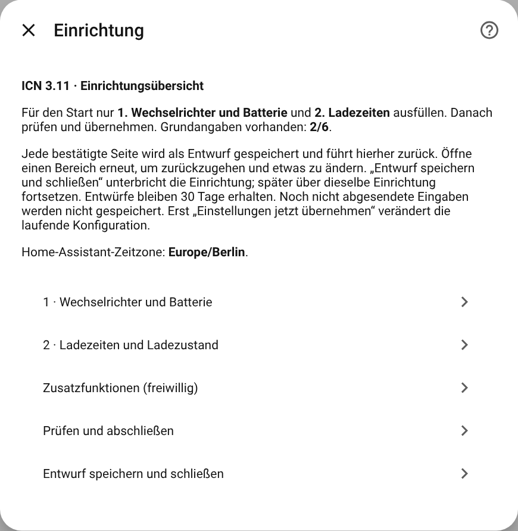
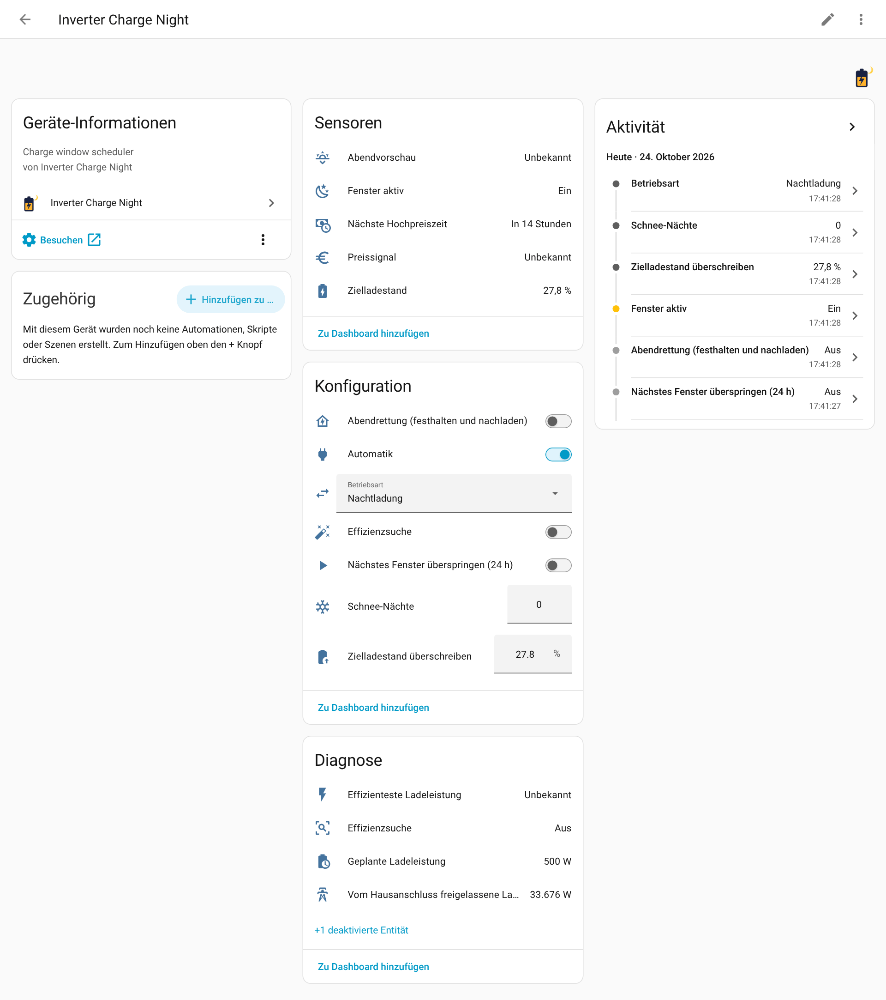

# Installation und erste Einrichtung

[🇬🇧 English](../en/installation.md) · [Übersicht der Dokumentation](README.md)

## Was du brauchst

| | |
|---|---|
| **Home Assistant** | 2025.2 oder neuer |
| **Eine Wechselrichter-Integration** | Irgendeine, die deinen Wechselrichter als Entitäten bereitstellt: eine **Zahl** (number) für den Mindestladestand des Akkus, einen **Schalter** (switch) für das Netzladen und einen **Sensor** für den Ladestand. Beispiele: [KOSTAL KORE](https://github.com/Puma7/KostalKore), die eingebaute Kostal-Plenticore-Integration, SMA, Fronius, Solax oder eine eigene Modbus-Konfiguration. |
| **Eine PV-Prognose** | Ein Sensor mit dem erwarteten Ertrag von morgen in kWh, zum Beispiel [Solcast](https://github.com/BJReplay/ha-solcast-solar) oder [Forecast.Solar](https://www.home-assistant.io/integrations/forecast_solar/). |
| **Optional** | Ein Zähler für den Hausverbrauch (kWh) für das gelernte Lastprofil, ein Netzbezugssensor (W) für die Begrenzung am Hausanschluss, eine beschreibbare Ladegrenze (W) für die Steuerung der Ladeleistung und die Effizienzsuche, eine `weather.*`-Entität für das Heizen. |

ICN spricht nicht selbst mit dem Wechselrichter. Es hat keinen Modbus-Code, kein Cloud-Konto und
kein Herstellerprotokoll. Es schreibt nur in Home-Assistant-Entitäten, die deine
Wechselrichter-Integration bereitstellt. Deshalb funktioniert es mit jedem Wechselrichter, der diese
Steuerungen anbietet. Entwickelt und getestet wurde es an einem Kostal Plenticore G3 mit
KOSTAL KORE; siehe [Kostal mit KOSTAL KORE](kostal-kore.md).

## Installieren

### Mit HACS (empfohlen)

1. Installiere [HACS](https://hacs.xyz/docs/use/), falls du es noch nicht hast.
2. Klicke auf die Schaltfläche oben oder öffne **HACS → ⋮ → Benutzerdefinierte Repositories** und
   füge `https://github.com/Puma7/InverterChargeNight` mit dem Typ **Integration** hinzu.
3. Suche nach **Inverter Charge Night**, lade es herunter und starte Home Assistant neu.

Updates kommen danach über HACS, wie bei jeder anderen Integration.

### Von Hand

1. Kopiere `custom_components/inverter_charge_night` aus dem
   [neuesten Release](https://github.com/Puma7/InverterChargeNight/releases/latest) in dein
   Konfigurationsverzeichnis, sodass `<config>/custom_components/inverter_charge_night/manifest.json`
   existiert.
2. Starte Home Assistant neu.

## Einrichten

**Einstellungen → Geräte & Dienste → Integration hinzufügen → Inverter Charge Night.** Die
Einrichtung ist eine Übersicht mit kurzen Seiten. Zwei Seiten sind Pflicht. Alles andere ist
freiwillig und lässt sich später unter **Konfigurieren** ergänzen.

**1 · Wechselrichter und Batterie**

| Feld | Was du wählst |
|---|---|
| Mindestladestand am Wechselrichter einstellen | Die Zahl-Entität des Wechselrichters für den Mindestladestand des Akkus. Sie kennzeichnet auch die Einrichtung, deshalb lässt sich jeder Wechselrichter nur einmal einrichten. |
| Netzladen am Wechselrichter einschalten | Der Schalter, mit dem der Wechselrichter den Akku aus dem Netz lädt. |
| Aktuellen Akkuladestand messen | Der aktuelle Ladestand in %. |
| Bruttokapazität des Akkus | Die Kapazität für 0–100 % des gemeldeten Ladestands, bevor dein Min-SOC abgezogen wird. Ein Akku mit 35,8 kWh und 8 % Untergrenze hat 35,8 kWh, nicht 32,9. |
| PV-Ertragsprognose für morgen | Die Prognose für **morgen**, in kWh. |

Ist genau ein Wechselrichter mit KOSTAL KORE installiert, werden die ersten drei Felder
automatisch vorgeschlagen. Prüfe sie, bevor du weitermachst.

**2 · Ladezeiten und Ladezustand**

| Feld | Was du wählst |
|---|---|
| Beginn / Ende des günstigen Ladefensters | Das günstige Fenster, in der Zeitzone von Home Assistant. Es darf über Mitternacht laufen (23:00–05:00). Lass auf beiden Seiten ein paar Minuten Abstand zur Tarifgrenze (23:01–04:58). |
| Untergrenze / Obergrenze des Ladeziels | Der Bereich, in dem das Ziel gehalten wird. |

**Prüfen und abschließen → Einstellungen jetzt übernehmen** legt die Konfiguration an. Bis dahin
wird der Wechselrichter nicht angefasst. **Entwurf speichern und schließen** unterbricht die
Einrichtung. Der Entwurf bleibt 30 Tage erhalten, auch über einen Neustart hinweg. Öffne den
Dialog erneut und wähle **Gespeicherten Entwurf fortsetzen**.

## Nach der Einrichtung

Du bekommst ein Gerät, **Inverter Charge Night**, mit seinen Entitäten
([Liste](entities-and-actions.md)). Die wichtigste ist der Sensor **Zielladestand**. Er zeigt, was
der Planer im Akku haben will, und seine Attribute sagen, warum.

Empfohlene nächste Schritte, alle unter **Konfigurieren**:

1. **Prognose, Reserve und Jahreszeit → PV-Prognose und Morgenreserve**: Planer **Überbrückung**,
   die **Prognose für heute** (nötig für Fenster über Mitternacht und für die Abendvorschau) und
   ein **Zähler für den Hausverbrauch**.
2. **Sicherheitspuffer, Sicherheitsniveau und Wetter**: ein Puffer von ein paar kWh,
   Sicherheitsniveau *Sicher (75. Perzentil)* und der **modellierte** Tag. Füge eine
   Wetter-Entität hinzu, wenn du mit einer Wärmepumpe heizt.
3. **Ladeleistung begrenzen**: die beschreibbare Ladegrenze des Wechselrichters in W. Dann wird
   die Ladung über das Fenster verteilt, statt mit voller Leistung zu laufen.
4. **Inselbetrieb erkennen**: wenn du einen Notstrom- oder Umschalter hast. ICN lässt den
   Wechselrichter dann bei einem Stromausfall los
   ([Sicherheit](safety.md#stromausfall-und-inselbetrieb)).
5. **Hausanschluss begrenzen**: wenn Wallboxen oder eine Wärmepumpe den Anschluss mit dem Akku
   teilen ([Sicherheit](safety.md#hausanschluss)).

Alle Einstellungen sind in der [Referenz der Konfiguration](configuration.md) erklärt.

## Einstellungen später ändern

- **Konfigurieren** (auf der Karte der Integration) öffnet dieselbe Übersicht wie bei der ersten
  Einrichtung. Nicht betroffene Bereiche, gelernte Effizienzdaten und der Laufzeitzustand
  bleiben erhalten.
- **Neu konfigurieren** (im Menü ⋮) bietet dieselben Seiten und nimmt außerdem eine neue
  Min-SOC-Entität an, etwa für einen getauschten Wechselrichter oder eine umbenannte Entität.

## Entfernen

**Einstellungen → Geräte & Dienste → Inverter Charge Night → ⋮ → Löschen.** Läuft gerade ein
Fenster, gibt ICN zurück, was es verändert hat, bevor der Eintrag verschwindet. Schlägt dieses
Zurücksetzen fehl, wird es nicht wiederholt. Prüfe danach also den Min-SOC des Wechselrichters.
Entferne die Integration dann in HACS (oder lösche den Ordner) und starte neu.
