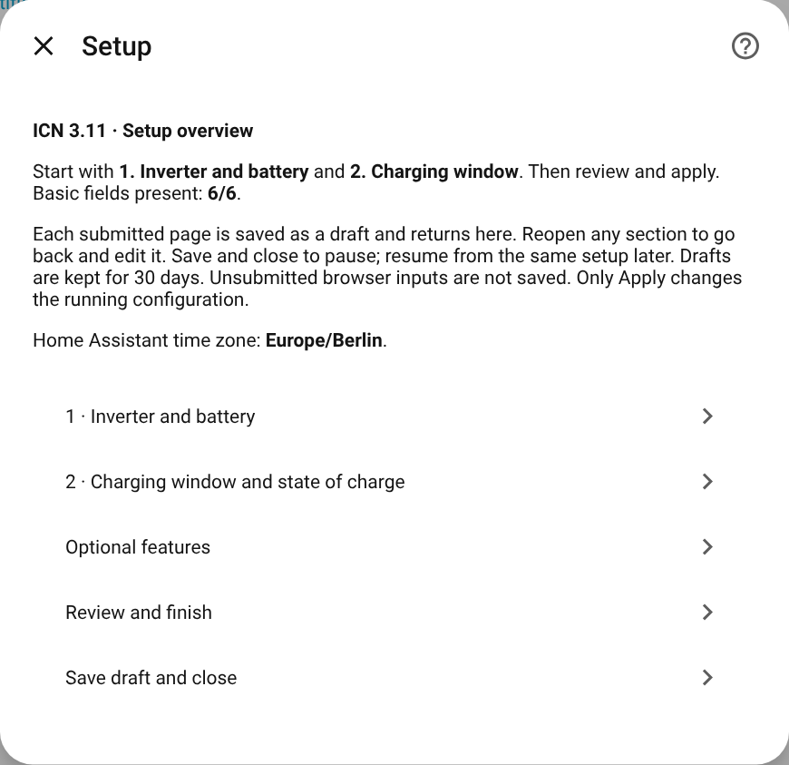
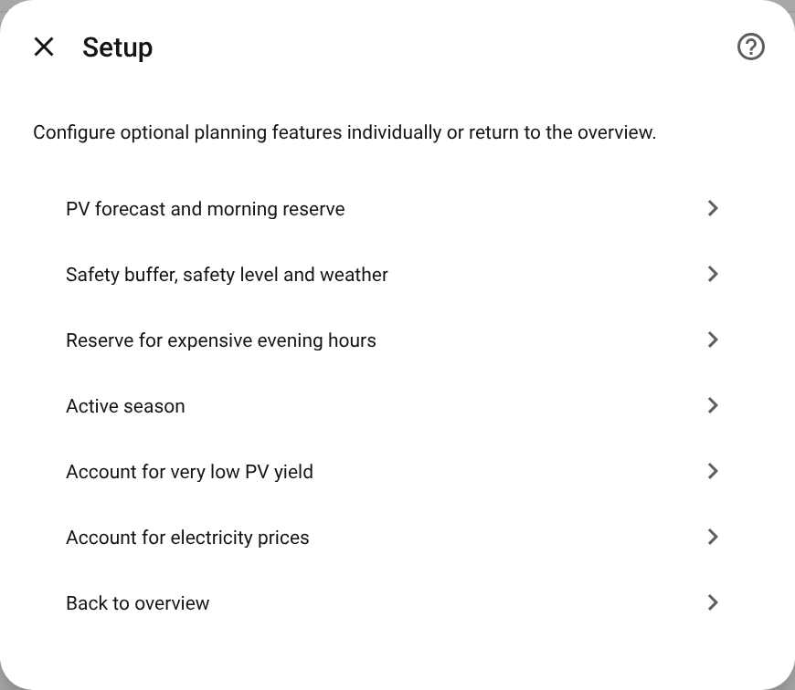
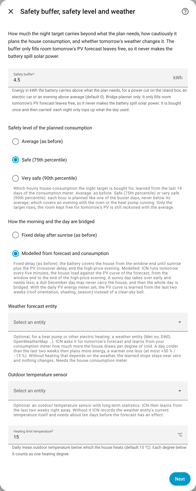

# Configuration reference

[🇩🇪 Deutsch](../de/configuration.md) · [Documentation overview](README.md)

Everything is set in the user interface: **Settings → Devices & services → Inverter Charge Night
→ Configure**. The dialog is an overview. Each page saves into a draft, and only **Apply settings
now** changes the running configuration. The field names below are the ones the dialog shows;
the key in brackets is what the diagnostics and the code call it.

- [Required pages](#required-pages)
- [Limit charging power](#limit-charging-power)
- [Limit house connection import](#limit-house-connection-import)
- [Set up efficiency search](#set-up-efficiency-search)
- [Forecast, reserves and season](#forecast-reserves-and-season)
- [Other features and hardware](#other-features-and-hardware)
- [Suggested settings](#suggested-settings)

## Required pages

### 1 · Inverter and battery

| Field | Default | Meaning |
|---|---|---|
| Name for this setup (`name`) | Inverter Charge Night | Any name. It does not rename the inverter's entities. |
| Set inverter minimum battery SOC (`min_soc_entity`) | – | The writable minimum SOC number of the inverter. It also identifies the setup: one setup per inverter. |
| Enable inverter grid charging (`grid_charge_switch`) | – | The switch that lets the inverter charge from the grid. |
| Measure current battery SOC (`battery_soc_entity`) | – | The measured state of charge in %. |
| Gross battery capacity (`battery_capacity`) | – | kWh for 0–100 % of the reported state of charge. Do not subtract the minimum SOC. |
| PV energy forecast for tomorrow (`pv_forecast_entity`) | – | Tomorrow's full-day forecast in kWh. Not an ICN sensor such as the evening outlook. |

### 2 · Charging window and state of charge

| Field | Default | Meaning |
|---|---|---|
| Cheap charging window starts / ends (`start_time`, `end_time`) | 00:00 / 05:59 | Local time in Home Assistant's time zone. May cross midnight. |
| Lower / upper bound for planned charging target (`user_min_soc`, `user_max_soc`) | 8 % / 100 % | The target is always kept inside this range. |

## Limit charging power

Without a charge limit, the inverter charges at whatever power it chooses. With one, ICN writes
the constant power that reaches the target exactly at the end of the window: in Bridge mode,
with a house connection limit, or once the efficiency search has found an optimum. In Headroom
mode without either, the *Planned charge power* sensor only shows the plan (attribute `applied`).

| Field | Default | Meaning |
|---|---|---|
| Set inverter charging power (`charge_power_entity`) | – | A writable charge ceiling in W (or kW) that reads back. Not a percentage setpoint such as Kostal's *Active Power Set Point*. |
| Lowest usable charging power (`min_charge_power_w`) | 1000 W | A smaller plan is raised to this. Only when the house connection leaves less than this does charging pause. |
| Highest permitted charging power (`max_charge_power_w`) | 10000 W | Upper bound for planning and the efficiency search. Must not exceed the ratings of inverter, battery and installation. |

## Limit house connection import

Keeps the total grid import under a continuous budget by holding the battery back
([details](safety.md#house-connection)). All four fields are needed together.

| Field | Default | Meaning |
|---|---|---|
| Measure total house grid import (`grid_import_entity`) | – | Total import at the connection point, positive, in W or kW, including battery and cars. |
| Permitted continuous house grid import (`grid_max_continuous_w`) | – | The budget in W shared by every consumer. |
| Safety headroom below import budget (`grid_headroom_w`) | 500 W | Kept free on top. |
| Set inverter charging power (`charge_power_entity`) | – | As above. |

Instead of the budget you can let ICN calculate it from the fuse: **Other features and hardware →
Calculate import budget from fuse rating** (main fuse per phase, phases (3), phase voltage
(230 V), continuous load share (80 %)). 63 A on three phases gives 43.5 kW nominal and 34.8 kW
continuous. A budget entered directly takes precedence over the fuse calculation, and saving the
fuse page removes such a budget.

## Set up efficiency search

Measures at which charge power the least energy is lost and then keeps to it
([details](efficiency-search.md)). Needs the charge limit, the AC side of the charge and the
battery side:

| Field | Meaning |
|---|---|
| House consumption (power) (`charge_power_house_entity`) | Recommended. What the house itself consumes in W, without the battery. With grid import it gives the charger's AC input: grid import minus house consumption. KOSTAL KORE: *Home Power*. |
| Grid import (power) (`grid_import_entity`) | The import at the house connection, positive while drawing. The same field as for the [house connection limit](#limit-house-connection-import). |
| AC input power used only for battery charging (`charge_power_sent_entity`) | Only instead of the pair above, and only a sensor that measures the charger's AC input itself. Not KOSTAL KORE *Grid to Battery Power*, which is the battery's DC power, nor the inverter's total AC power. |
| DC charging power received by battery (`charge_power_received_entity`) | The DC power arriving in the battery. KOSTAL KORE: *Battery Power*. Counted negative while charging, it is turned automatically. |

Two kWh meters for the same two quantities (page *Efficiency measurements and energy meters*)
are optional and make the result more accurate.

## Forecast, reserves and season

### PV forecast and morning reserve

| Field | Default | Meaning |
|---|---|---|
| Planner Mode (`planner_mode`) | Headroom | *Headroom*: only keeps room for the forecast. *Bridge*: also covers the house from the window end until the PV takes over ([how](how-it-works.md#bridge-recommended)). |
| Additional battery headroom for PV generation (`forecast_error_margin`) | 10 % | How far the forecast may be off. Applied on the safe side: more room for the sun, less sun for the evening. Replaced by the [learned band](learning.md) once 14 days of the season are known. |
| Fallback minimum SOC when restoring (`default_min_soc`) | the lower bound | Only used when the original minimum SOC could not be read. A new setup takes the lower bound of page 2. |
| PV energy forecast for today (`pv_forecast_today_entity`) | – | Needed for windows after midnight, the evening outlook and the curtailment outlook. |
| House Consumption Energy Meter (`house_load_entity`) | – | Cumulative kWh meter. ICN learns an hourly profile from the last 14 days. |
| Average House Load (`avg_house_load_kw`) | 0.5 kW | Used when there is no meter or no statistics yet. |
| PV Crossover Delay (`pv_crossover_delay_min`) | 90 min | Minutes after sunrise until the PV carries the house (fixed delay model). |
| Bridge Reserve (`bridge_reserve_kwh`) | 0.5 kWh | Added to the morning need. |

### Safety buffer, safety level and weather

| Field | Default | Meaning |
|---|---|---|
| Safety buffer (`safety_buffer_kwh`) | 0 kWh | Carried above the need, only into room the PV leaves free. Bought once, then carried. |
| Safety level of the planned consumption (`load_safety_level`) | Average | *Average*, *safe* (75th percentile) or *very safe* (90th percentile) of the last 14 days, per hour. |
| How the morning and the day are bridged (`bridge_model`) | Fixed delay | *Fixed delay* after sunrise, or *modelled*: tomorrow simulated every five minutes against the PV curve. |
| Weather forecast entity (`weather_entity`) | – | Optional, for electric heating: tomorrow's temperature scales the planned load. |
| Outdoor temperature sensor (`outdoor_temperature_entity`) | – | Optional: lets ICN learn from the last two weeks right away. |
| Heating limit temperature (`heating_limit_c`) | 15 °C | Daily mean below which the house heats. |

### Reserve for expensive evening hours

| Field | Default | Meaning |
|---|---|---|
| High-price period, start / end (`high_price_start`, `high_price_end`) | – | For example 18:00–21:00. Both or neither. |
| Allowance on the evening's consumption (`high_price_margin_pct`) | 0 % | Added on top of the learned average for the night plan. The high-price rescue reckons without it. |
| Discharge block for reservations (`discharge_block_mode`) | Automatic | For explicit reservations and the high-price rescue: *Automatic* raises the minimum SOC to the level being held, *Off* keeps only the target. Scheduled nights are not affected. |
| Block Discharge Switch (`discharge_block_switch`) | – | Legacy. Only used to give back a state that a version before 3.10.6 changed. |

### Active season

| Field | Default | Meaning |
|---|---|---|
| Active Start / End Date | – | Only run between these dates. Empty means all year. |
| Repeat the date range every year | On | Only day and month count, so 1 October – 31 March comes back every winter. Off: the dates are absolute, and after the end date ICN stops for good (and says so under Repairs). |

### Account for very low PV yield

With today's forecast and a daily PV energy meter (`pv_energy_today_entity`, reset every day),
ICN compares the day's forecast with what was really produced. A day with at least 5 kWh
expected and no more than 15 % delivered arms the next night at the maximum SOC
([details](extras.md#very-low-pv-yield)). The same meter feeds the learned PV curve of the
modelled day.

### Account for electricity prices

| Field | Meaning |
|---|---|
| Night / Day / Feed-in Price (ct/kWh) | Fixed prices, all three or none. They decide a conflict between the morning need and the room for the PV. |
| Electricity price entity | Optional: a sensor with hourly prices for today and tomorrow (Tibber, aWATTar, EPEX Spot, Nordpool, ENTSO-e and similar). It replaces the night and day price. The feed-in price stays a fixed field. The [high-price rescue](extras.md#high-price-rescue) buys from the grid only with it. |
| What the prices are in | Detect automatically, or set the unit if the entity carries none. |
| Surcharge on the exchange price / inside the window | What your bill adds to the entity's price (grid fee, levies, VAT). The second value is for a reduced §14a grid fee in the window. |

The *Price signal* sensor shows which prices were used.

## Other features and hardware

| Page | Fields |
|---|---|
| **Efficiency measurements and energy meters** | The power sensors of the efficiency search, plus optional kWh meters for both sides. |
| **Detect island operation** | Backup / island mode entity, and the states that mean island operation if it is a plain sensor (Kostal: `ESB`). Strongly recommended with a backup or transfer switch ([details](safety.md#power-cut-and-island-operation)). |
| **Additional hardware limits** | A second, independent charge ceiling (entity and value, both or neither). Usually empty. The *Discharge Power Limit Entity* is legacy, only to give back an old value. |
| **Calculate import budget from fuse rating** | See [house connection](#limit-house-connection-import). |
| **Other settings** | Update interval (900 s), command delay (0.1 s), charge efficiency (0.90) and discharge efficiency (0.95), the feed-in cap and feed-in power entity for the [curtailment outlook](extras.md#curtailment-outlook), the operation mode, and the force discharge switch for [morning discharge](morning-discharge.md). |
| **Disable features** | Switches off the efficiency search, the house connection limit, the PV shortfall detection or the charge power control in one step. |

## Suggested settings

**A typical German §14a household with a heat pump** (35.8 kWh battery, window 23:00–05:00,
peak period 18:00–21:00):

| Setting | Value |
|---|---|
| Window | 23:01 – 04:58 |
| Min / max SOC | 8 % / 100 % |
| Planner mode | Bridge |
| Forecast for today | set |
| House consumption meter | set |
| Safety buffer | 4–5 kWh |
| Safety level | Safe (75th percentile) |
| Bridging | Modelled |
| Weather entity + outdoor sensor | set |
| High-price period | 18:00 – 21:00 |
| Charge limit | set (writable W control) |
| Island detection | set, if you have a transfer switch |
| Season | 1 October – 31 March, yearly |

**Starting carefully:** leave the planner on *Headroom*, set only the two required pages and the
island detection, and watch the *Target SOC* sensor for a few nights. Then switch to *Bridge* and
add the charge limit and the rest.
