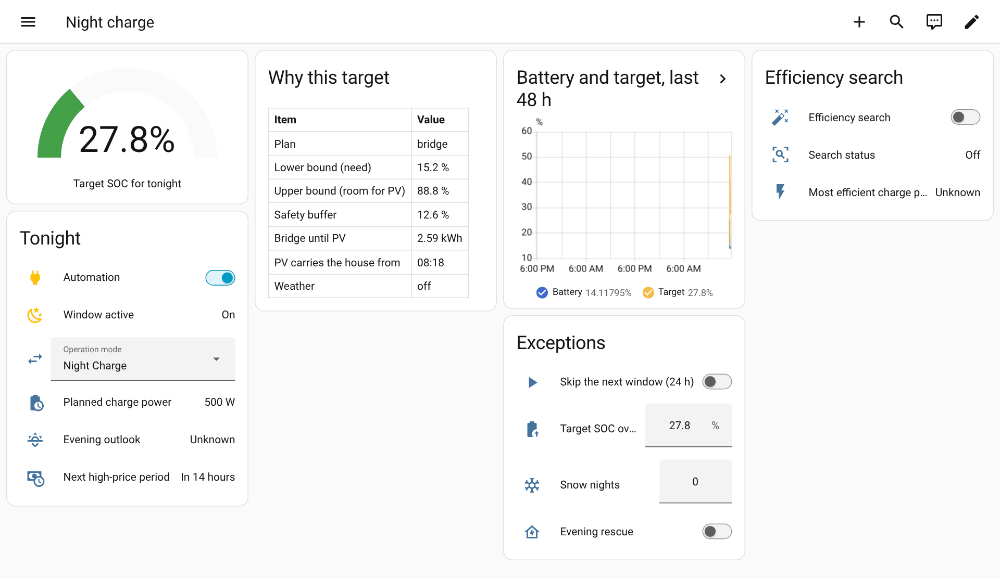

# Dashboard

[🇩🇪 Deutsch](../de/dashboard.md) · [Documentation overview](README.md)

An example view that uses only cards that ship with Home Assistant: the target as a gauge, the
night at a glance, why the target came out as it did, the last 48 hours, the exceptions and the
efficiency search.



## Adding it

1. Copy [`docs/examples/dashboard.yaml`](../examples/dashboard.yaml). It uses the entity ids of a
   Home Assistant set to English. On a German system take the
   [German version](../examples/dashboard.de.yaml), whose ids and titles are German.
2. Replace `sensor.battery_soc` with your battery's state of charge sensor. If your setup has a
   different name, adjust the ICN entity ids too. The efficiency search sensors are disabled by
   default; enable them on the device page, or remove the last card.
3. Open a dashboard, **Edit dashboard → ⋮ → Raw configuration editor**, and paste the view as one
   entry under `views:`. Or copy single cards into an existing view with **Add card → Manual**.

## Single cards

**Target and window:**

```yaml
type: entities
title: Tonight
state_color: true
entities:
  - switch.inverter_charge_night_automation
  - binary_sensor.inverter_charge_night_window_active
  - sensor.inverter_charge_night_target_soc
  - sensor.inverter_charge_night_planned_charge_power
  - sensor.inverter_charge_night_evening_outlook
```

**Battery against target over two days:**

```yaml
type: history-graph
title: Battery and target
hours_to_show: 48
entities:
  - entity: sensor.battery_soc
    name: Battery
  - entity: sensor.inverter_charge_night_target_soc
    name: Target
```
