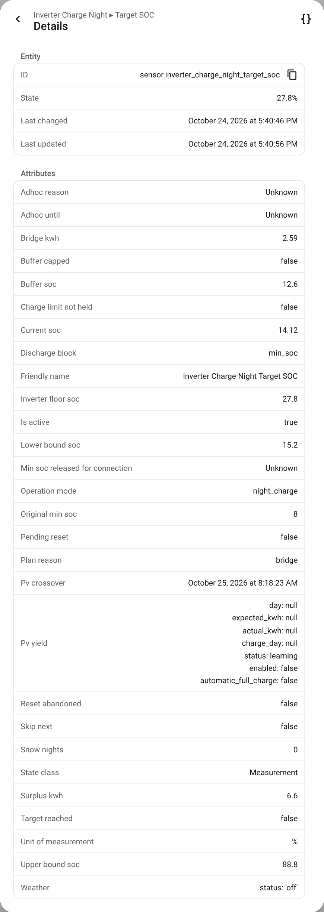

# Entities and actions

[🇩🇪 Deutsch](../de/entities-and-actions.md) · [Documentation overview](README.md)

All entities belong to one device, named after the *Name* field of the setup (default
**Inverter Charge Night**). The names are translated (English and German ship with the
integration). The entity ids below are the ones Home Assistant creates for the default name when
it is set to **English** at setup: Home Assistant forms entity ids in its system language. On a
German system they read, for example, `sensor.inverter_charge_night_zielladestand` (see the
[German page](../de/entities-and-actions.md)). With another name, or after an update from an older
version, check the ids on the device page.

## Entities

### Controls

| Name | Entity id | What it is for |
|---|---|---|
| Automation | `switch.inverter_charge_night_automation` | The main switch. Off: everything ICN changed is given back, and it controls nothing until switched on again. |
| Skip the next window (24 h) | `switch.inverter_charge_night_skip_the_next_window_24_h` | Skips one window, then expires by itself. |
| Evening rescue (hold and charge) | `switch.inverter_charge_night_evening_rescue_hold_and_charge` | Lets the [evening rescue](extras.md#evening-rescue) act. Off by default. |
| Efficiency search | `switch.inverter_charge_night_efficiency_search` | Starts the [efficiency search](efficiency-search.md). Switches itself off when it is done. |
| Operation Mode | `select.inverter_charge_night_operation_mode` | *Night Charge* or *Morning discharge (experimental)*. Switching during a window resets the inverter first. |
| Target SOC override | `number.inverter_charge_night_target_soc_override` | Replaces the planner's target until the window ends. |
| Snow nights | `number.inverter_charge_night_snow_nights` | Charges the next N nights to the maximum SOC. |

### Sensors

| Name | Entity id | What it shows |
|---|---|---|
| Target SOC | `sensor.inverter_charge_night_target_soc` | What the planner wants in the battery. Attributes below. |
| Window active | `binary_sensor.inverter_charge_night_window_active` | Whether a window is running right now. |
| Planned charge power | `sensor.inverter_charge_night_planned_charge_power` | The constant power that reaches the target at the window end, after all limits. |
| Charge power left by the house connection | `sensor.inverter_charge_night_charge_power_left_by_the_house_connection` | What the connection still allows the battery. Attributes `budget_w`, `grid_import_w`, `other_load_w`, `limited`. |
| Evening outlook | `sensor.inverter_charge_night_evening_outlook` | How many kWh the battery will be short when the high-price period starts. 0 means it will make it. |
| Next high-price period | `sensor.inverter_charge_night_next_high_price_period` | When it starts, how long it lasts, how much was reserved and how much of that tonight buys. |
| Price signal | `sensor.inverter_charge_night_price_signal` | The prices behind the last decision and where they came from (`entity` or `static`). |
| Efficiency search | `sensor.inverter_charge_night_efficiency_search` | What the search is doing and what it has measured. |
| Most efficient charge power | `sensor.inverter_charge_night_most_efficient_charge_power` | The result of the efficiency search. |
| Curtailment outlook | `sensor.inverter_charge_night_curtailment_outlook` | PV lost to a feed-in cap. Disabled by default. |

### Attributes of *Target SOC*



| Attribute | Meaning |
|---|---|
| `is_active`, `target_reached` | Window running; target reached. |
| `current_soc` | The battery's state of charge. |
| `plan_reason` | `bridge`, `conflict_bridge_wins`, `conflict_headroom_wins` or `fallback`. Bridge mode only; empty in Headroom mode, like the other plan attributes. |
| `lower_bound_soc`, `upper_bound_soc` | The two bounds of the Bridge planner, in %. |
| `bridge_kwh`, `surplus_kwh` | Morning need and tomorrow's surplus, in kWh. |
| `buffer_soc`, `buffer_capped` | Safety buffer applied, in %, and whether the upper bound cut it short. |
| `pv_crossover` | When the PV is expected to carry the house. |
| `weather` | Status of the weather factor: `off`, `learning`, `active`, `forecast_unavailable`, with kWh per kelvin and factor. |
| `inverter_floor_soc`, `discharge_block` | The minimum SOC the inverter should show, and how the battery is held (`min_soc` / `off`). |
| `snow_nights`, `skip_next`, `operation_mode` | The current exceptions and mode. |
| `adhoc_reason`, `adhoc_until` | A running evening rescue or action window. |
| `original_min_soc`, `pending_reset`, `reset_abandoned` | The stored original and the state of the restore. |
| `charge_limit_not_held`, `min_soc_released_for_connection` | Protections of the house connection that have triggered. |
| `pv_yield` | The PV shortfall detection. |

## Actions

All actions take an optional `config_entry_id`. With only one setup it can be left out.

### `inverter_charge_night.plan_target_soc`

Runs the Bridge planner on the current inputs and **returns the result without writing
anything**, whatever the planner mode. Snow nights, the override and the PV shortfall detection
are not applied.

```yaml
alias: Tell me tonight's target
triggers:
  - trigger: time
    at: "22:30:00"
actions:
  - action: inverter_charge_night.plan_target_soc
    response_variable: plan
  - action: notify.persistent_notification
    data:
      message: >-
        Tonight: {{ plan.target_soc }} % ({{ plan.reason }}),
        need {{ plan.lower_bound_soc }} %, room up to {{ plan.upper_bound_soc }} %
```

The response contains `target_soc`, `reason`, `lower_bound_soc`, `upper_bound_soc`, `bridge_kwh`,
`surplus_kwh`, `current_soc`, `forecast_kwh`, `forecast_available`, `window_end`, `pv_crossover`
and `sunset`.

### `inverter_charge_night.charge_to`

Charges the battery from the grid to a level, for a while (`duration`, two hours by default).
Everything the night window does applies: house connection limit, capture and restore. Refused
while the configured window runs and in morning discharge mode.

```yaml
alias: Top up before the expensive evening
triggers:
  - trigger: time
    at: "16:00:00"
conditions:
  - condition: numeric_state
    entity_id: sensor.inverter_charge_night_evening_outlook
    above: 0.5
actions:
  - action: inverter_charge_night.charge_to
    data:
      target_soc: 60
      duration: {hours: 2}
```

### `inverter_charge_night.block_discharge` and `allow_discharge`

`block_discharge` keeps the battery from running the house for a while (`duration`), without
buying anything. `allow_discharge` ends such a hold, or a `charge_to`, early and hands the
inverter back.

### `inverter_charge_night.reset_inverter`

Gives back the minimum SOC, the charge limits and the switches, the same reset the window end
performs. Inside a running window it **ends that window**, and ICN leaves the inverter alone until
the window's end time. Refused during island operation.

```yaml
alias: Hand the inverter over when the wallbox starts
triggers:
  - trigger: state
    entity_id: binary_sensor.wallbox_charging
    to: "on"
actions:
  - action: inverter_charge_night.reset_inverter
```

### `inverter_charge_night.communication_diagnostics`

Returns the communication state and its incident history, without device requests or writes.

All actions report failure as an error an automation can catch: an unknown entry, a plan that
could not be produced, an inverter that did not accept the reset.

## More automation ideas

**Charge for the car on a dull day.** When tomorrow's forecast is poor, raise the target by hand:

```yaml
alias: Dull day, charge more
triggers:
  - trigger: time
    at: "22:00:00"
conditions:
  - condition: numeric_state
    entity_id: sensor.solcast_pv_forecast_forecast_tomorrow
    below: 5
actions:
  - action: number.set_value
    target:
      entity_id: number.inverter_charge_night_target_soc_override
    data:
      value: 80
```

**Skip the night while on holiday:**

```yaml
alias: Holiday, no grid charging
triggers:
  - trigger: state
    entity_id: input_boolean.holiday
    to: "on"
actions:
  - action: switch.turn_off
    target:
      entity_id: switch.inverter_charge_night_automation
```
