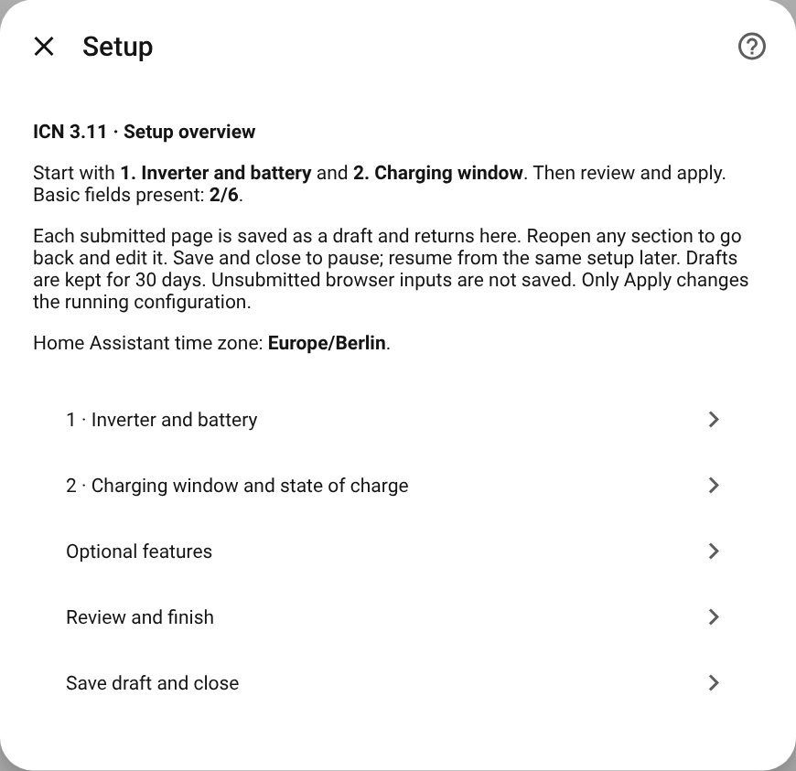
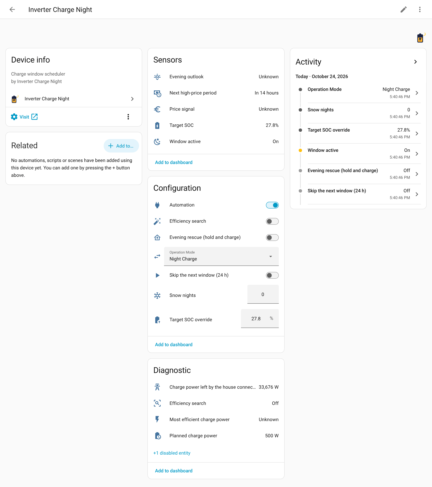

# Installation and first setup

[🇩🇪 Deutsch](../de/installation.md) · [Documentation overview](README.md)

## What you need

| | |
|---|---|
| **Home Assistant** | 2025.2 or newer |
| **An inverter integration** | Anything that exposes your inverter as entities: a **number** for the battery's minimum state of charge, a **switch** for grid charging and a **sensor** for the state of charge. Examples: [KOSTAL KORE](https://github.com/Puma7/KostalKore), the built-in Kostal Plenticore, SMA, Fronius, Solax, or a Modbus configuration of your own. |
| **A PV forecast** | A sensor with tomorrow's expected yield in kWh, for example [Solcast](https://github.com/BJReplay/ha-solcast-solar) or [Forecast.Solar](https://www.home-assistant.io/integrations/forecast_solar/). |
| **Optional** | A house consumption meter (kWh) for the learned load profile, a grid import sensor (W) for the house connection limit, a writable charge limit (W) for charge power control and the efficiency search, a `weather.*` entity for heating. |

ICN does not talk to the inverter itself. It has no Modbus code, no cloud account and no vendor
protocol. It only writes to Home Assistant entities that your inverter integration provides,
which is why it works with any inverter that offers those controls. It was developed and is
tested on a Kostal Plenticore G3 with KOSTAL KORE; see [Kostal with KOSTAL KORE](kostal-kore.md).

## Installing

### With HACS (recommended)

1. Install [HACS](https://hacs.xyz/docs/use/) if you do not have it yet.
2. Click the button above, or open **HACS → ⋮ → Custom repositories**, add
   `https://github.com/Puma7/InverterChargeNight` with the type **Integration**.
3. Search for **Inverter Charge Night**, download it and restart Home Assistant.

Updates then arrive through HACS like for any other integration.

### Manually

1. Copy `custom_components/inverter_charge_night` from the
   [latest release](https://github.com/Puma7/InverterChargeNight/releases/latest) into your
   configuration directory, so that `<config>/custom_components/inverter_charge_night/manifest.json`
   exists.
2. Restart Home Assistant.

## Setting it up

**Settings → Devices & services → Add integration → Inverter Charge Night.** The setup is an
overview with short pages. Two pages are required, everything else is optional and can be added
later under **Configure**.

**1 · Inverter and battery**

| Field | What to choose |
|---|---|
| Minimum SOC entity | The inverter's number entity for the battery's minimum state of charge. It also identifies the configuration, so every inverter can only be set up once. |
| Grid charge switch | The switch that lets the inverter charge the battery from the grid. |
| Battery SOC sensor | The current state of charge in %. |
| Battery capacity | The capacity for 0–100 % of the reported state of charge, before your minimum SOC is taken off. A 35.8 kWh battery with an 8 % floor is 35.8 kWh, not 32.9. |
| PV forecast | The forecast for **tomorrow**, in kWh. |

With exactly one KOSTAL KORE inverter installed, the first three fields are suggested
automatically. Check them before you continue.

**2 · Charging window and state of charge**

| Field | What to choose |
|---|---|
| Start / end | The cheap window, in Home Assistant's time zone. It may cross midnight (23:00–05:00). Leave a few minutes on both sides of the tariff boundary (23:01–04:58). |
| Minimum / maximum SOC | The range the target is kept in. |

**Review and finish → Apply settings now** creates the configuration. Until then nothing touches
the inverter. **Save draft and close** pauses the setup. The draft is kept for 30 days and
survives a restart; open the dialog again and choose **Resume saved draft**.

## After the setup

You get one device, **Inverter Charge Night**, with its entities ([list](entities-and-actions.md)).
The most important one is the **Target SOC** sensor. It shows what the planner wants in the
battery, and its attributes say why.

Recommended next steps, all under **Configure**:

1. **Forecast, reserves and season → PV forecast and morning reserve**: planner mode **Bridge**,
   the **forecast for today** (needed for windows across midnight and for the evening outlook) and
   a **house consumption meter**.
2. **Safety buffer, safety level and weather**: a buffer of a few kWh, safety level *safe*, and
   the **modelled** day. Add a weather entity if you heat with a heat pump.
3. **Limit charging power**: the inverter's writable charge limit in W, so the charge is spread
   over the window instead of running at full power.
4. **Detect island operation**: if you have a backup or transfer switch. ICN then lets go of the
   inverter during a power cut ([Safety](safety.md#power-cut-and-island-operation)).
5. **Limit house connection import**: if wallboxes or a heat pump share the connection with the
   battery ([Safety](safety.md#house-connection)).

All settings are explained in the [configuration reference](configuration.md).

## Changing settings later

- **Configure** (on the integration's card) opens the same overview as the first setup. Unrelated
  sections, learned efficiency data and the runtime state are kept.
- **Reconfigure** (in the ⋮ menu) offers the same pages and also accepts a new minimum SOC entity,
  for a replaced inverter or a renamed entity.

## Removing it

**Settings → Devices & services → Inverter Charge Night → ⋮ → Delete.** If a window is running,
ICN gives back what it changed before the entry disappears. A reset that fails then is not
retried, so check the inverter's minimum SOC afterwards. Then remove it in HACS (or delete the
folder) and restart.
